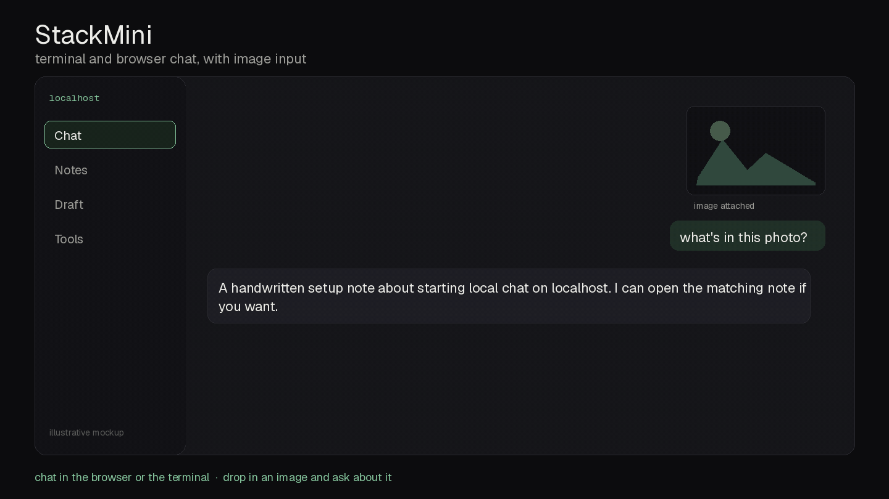
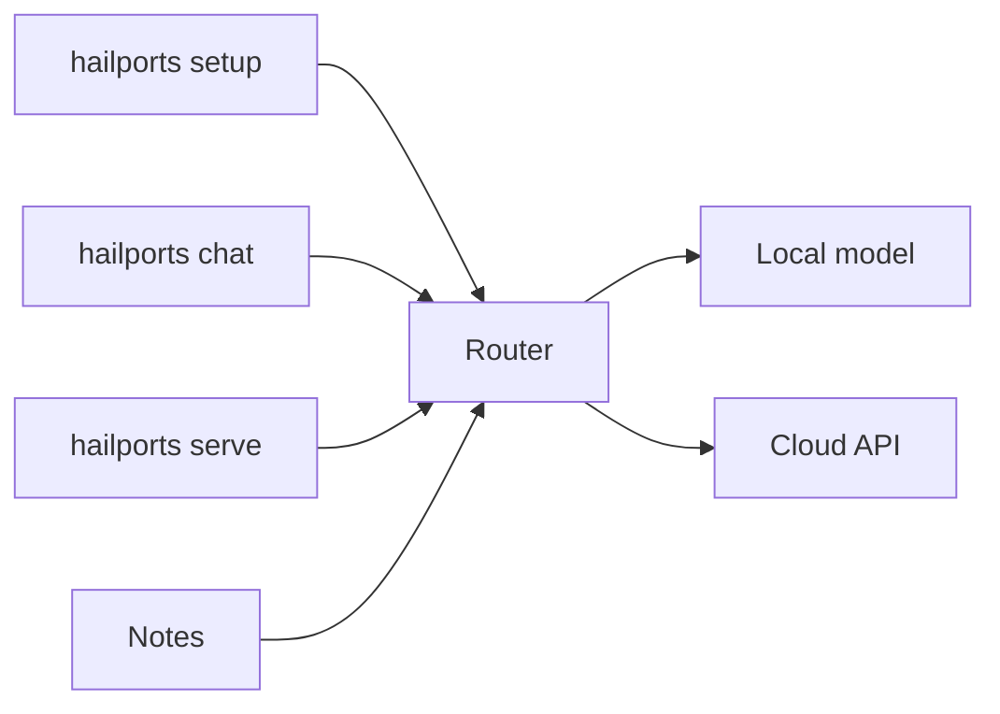

# HailPorts appliance

Chat, a private note file, and drafts that stick to notes you provide. One command, `hailports`, runs it on macOS (Apple silicon and Intel), Windows 10 and 11, and Linux (Ubuntu, Debian, Fedora, Arch).

It can use a local llama.cpp model, a hosted OpenAI-compatible endpoint, or both.

## Demo



Illustrative walkthrough of StackMini chat (with image input), notes with embeddings, grounded drafts that cite your notes, runbooks, idle work, a watchdog, the macOS iMessage bridge, and `hailports doctor`. Mockup, not a live capture. It listens on localhost by default and sends no telemetry.

## Features

- Command line chat against a local OpenAI-compatible server
- Local-first route. A summary, search, triage, or log read finishes on the local model. A production change, a team-facing note, hard code, or an unsure reply escalates with a short brief. A paid CLI starts only if you pass `--execute-escalate` and the local result says to escalate. See `hailports/local_first.py`.
- Web chat that lets an interactive turn go ahead of a batch turn
- Optional iMessage poll on macOS
- Telegram, Signal, and Matrix bridge stubs (off until you set a token)
- Web fetch, web search, and news feeds. Page text is cleaned before the model sees it
- Ask / do that reads notes and runbooks, then asks the model. It does not change files
- Grounded drafter. A line without a source citation is held. A quoted scheduling line does not hide a later note. Each skip is logged with its reason and the subject or sender
- Draft queue, story card, sprint packet, and calendar focus blocks as an `.ics` file
- Duplicate-card guard, including a near-duplicate title
- Notes database with file and page ingest, bge-small embeddings, and hybrid search
- Freshness check that restarts a dead embed server through the service manager
- Focus list, correction memory that is written back into the prompt and a runbook
- Idle jobs (refresh notes, summarize the thread, digest news, one deep note at a time) so a free model still works. Linked clips for the next item are gathered while the current note is written
- Whole-thread chat memory, a summary when the thread gets long, and `reset`
- Memory budget that restarts a service only through the service manager, and only when the recorded process id still matches
- Login-failure alert to a loopback channel and a local outbox
- Service-file hash
- Plugs for a CRM, a tracker, mail, meetings, and a file library. Placeholder config keeps them off
- Optional TypeSafe System One (Jev) classifier for cheap yes/no, choice, and score judgments. Fail-open. Kill switch `JEV_DISABLE=1`. See `contrib/jev/README.md`

## Modes

Pick the mode in `hailports setup`. Change it later with `hailports mode`.

| Mode | What runs |
| --- | --- |
| local | Every feature uses the local llama.cpp server. Nothing is sent to a hosted model. |
| hybrid | The local model reads, summarizes, retrieves, drafts, and compresses. A cloud model is used only when the reply looks unsure, the request is complex, or the reply is very long. The cloud call gets a short precomputed packet, and the stats line shows how many tokens that saved. |
| api | No local model, no llama.cpp build, and no model download. Chat, notes embeddings, drafts, vision, and web tools call a hosted endpoint. This is the mode for a small machine. |

Hosted providers: any OpenAI-compatible base URL (OpenAI, xAI, OpenRouter, Groq, Together, or another local server), plus Anthropic and Google adapters. The API key belongs in `HAILPORTS_API_KEY` or the OS keychain. It is not written to the config file.

Every reply ends with a stats line that names the provider, for example `hailports-stats provider=local mode=local ...`.

`hailports doctor` checks the mode you picked. In api mode it does not look for a local model.

## Layout



Web chat listens on 127.0.0.1 port 8080 and talks to llama-server on port 18080. Notes default to port 8078. Embeddings, if you run them, default to port 8097. Change the ports in the config file.

## Requirements

- Python 3.10 or newer
- A few GB of disk for a small model, or about 16 GB for the vision model described in `docs/MODEL.md`
- On macOS, Xcode command line tools if you build llama.cpp yourself
- On Windows, the prebuilt zip, or Visual Studio build tools if you compile
- On Linux, the Ubuntu prebuilt is tried first. A source build needs cmake and a C++ compiler (`build-essential` on Debian and Ubuntu, `gcc-c++` and cmake on Fedora, `base-devel` and cmake on Arch)

Python packages come from the project file:

```sh
python -m pip install .
```

HEIC photos need the optional extra, which is not installed by default:

```sh
python -m pip install "hailports-appliance[heif]"
```

If that extra is missing, `hailports chat --image photo.heic` stops with that install command. Tests and the interactive wizard driver are the `dev` extra: `python -m pip install ".[dev]"`.

## Quick start

```sh
pipx install .
hailports setup
```

`python -m pip install --user .` then `hailports setup` is the same bootstrap when pipx is not installed. The console command is `hailports` on macOS, Windows, and Linux.

Setup is a guided terminal wizard. It explains each step, accepts `back` and `skip`, and can be run again. `--yes` accepts the defaults without questions. When a step fails, it says what went wrong, how to fix it, and offers a retry. After a model or an API key is in place, `hailports ask "why did the build fail"` answers from the setup log.

```sh
hailports doctor
hailports chat
hailports serve
```

Add `--model tiny` for a plumbing-sized GGUF, `small` under 8 GB, `balanced` for a 7B text model, or `vision` for MiniCPM-V 4.7 when you have about 20 GB and Metal or CUDA.

Copy `config.example.yaml` if you want to edit by hand. Leave the token fields as `CHANGE_ME`. Put real tokens in the environment names from `.env.example`. A value in the yaml file is ignored.

## Per system

### macOS

```sh
python3 -m pip install --user .
hailports setup
```

Apple silicon and Intel both use a Metal llama.cpp build when you compile, or the matching macOS tarball when you download. Services are launchd agents. The label is whatever you type at the prompt (default `com.hailports.darwin`). iMessage is optional and stays off unless you pass `--modules` including `imessage`. The model listens on 127.0.0.1.

### Windows

```powershell
py -m pip install --user .
hailports setup
```

CPU, CUDA, Vulkan, or ROCm zip from the llama.cpp releases. The installer writes a Task Scheduler XML in UTF-8. You can point NSSM at the same `llama-server` command if you would rather have a service. Auto-heal calls `schtasks /Run` for that task name. It does not kill processes by image name. The model listens on 127.0.0.1.

### Linux

```sh
python3 -m pip install --user .
hailports setup
```

Ubuntu, Debian, Fedora, and Arch share the detection path. A user systemd unit is the service. If `systemctl --user` is not available, the unit file is still written and you can start `llama-server` in the foreground with the command the installer prints. Auto-heal uses `systemctl --user restart` and only when the stored process id is still the one the service owns. The model listens on 127.0.0.1.

## Commands

`hailports --help` lists them. Each command has its own `--help`.

- `setup` guided install
- `doctor` test the current mode
- `mode` show or switch local, hybrid, or api
- `chat` a terminal chat. `reset` drops the thread. `--image` attaches a picture
- `serve` web chat on 127.0.0.1
- `brain` ingest, ingest-path, search, status, and ask
- `notes` the same note file: ingest, search, status, and ask
- `brain-add` and `brain-find` for a note without embeddings
- `display` setup, status, list, apply, add, watch, restore, and reflow
- `drafter` a draft from notes you pass in with `--source`
- `draft` queue one grounded draft
- `services` install, start, stop, restart, status, and logs, through the service manager only
- `plugins` list, enable, and configure. Tokens are refused on the command line
- `ask` questions, including setup questions once a model or API is configured
- `idle` run one useful job
- `alerts` probe a login URL and write a local outbox
- `health` short reachability check
- `story` a story card
- `now` the focus list
- `learn` save a correction
- `sprint` pack a backlog into focus blocks
- `guard` refuse a duplicate card
- `block` write an `.ics` focus block
- `imessage` macOS poll hint, or a model reply
- `update` and `uninstall`

## Tests

```sh
python -m compileall -q hailports hailports_setup setup.py
python -m pytest -q
python -m hailports setup --dry-run --non-interactive --target-os linux
python -m hailports setup --dry-run --non-interactive --target-os darwin
python -m hailports setup --dry-run --non-interactive --target-os windows
```

`--target-os` simulates another system when you are not on it.

## Display and the phone keyboard

`hailports display` writes a HiDPI override (1x flag 1, 2x flag 9, tail `0x200000`), lists Mac 16:10, 16:9, and 4:3 sizes plus iPad native grids, and matches a viewer to a size. An iPad name selects the 13-inch panel at 1376x1032. An iPhone name selects 768x1024. A Mac name selects 16:10 (1680x1050). Anything else leaves the desktop alone.

Tailscale is optional. Pass a whois result you already have. Otherwise use the hostname, a VNC peer name, reverse DNS, mDNS, Screens, or Luna. The tool does not require the tailscale command.

`hailports display reflow` is the phone keyboard inset. It changes yabai's global bottom padding only when a fresh session file says `mobile_connected=1` and `mobile_profile=iphone`, and the focused display is 768x1024. The window bottom is y=761 and the padding is 202. Missing or stale state does nothing. See `docs/DISPLAY.md`.

Installing an override needs administrator rights once, then a logout or a display unplug/replug. Do not kill the window server. yabai needs its accessibility permission before the padding can change.

## Local bridges

Chat bridges (Telegram, Signal, Matrix) stay stubs. `hailports/local_bridges/` is the loopback session fabric: a mail draft bridge, a meetings bridge, a tracker bridge, and a browser CDP session. Drafts are saved. There is no send path. Unconfigured entries stay off. Health probes, idle recycle, and exact-pid restart are in that package. See `docs/LOCAL_BRIDGES.md`.

## Notes brain

`hailports notes` and `hailports brain` share one note file. `brain ask` searches with BM25 and local vectors, fuses them with reciprocal rank (`via: hybrid`), and can add a 2-hop graph (`via: graph`). The HTTP surface is `GET` or `POST /v1/ask` with `q`, `scope`, `k`, and `graph`. It binds to loopback unless you explicitly allow an overlay address. A token is optional. Questions about passwords, seed phrases, one-time codes, private keys, or legal and finance folders are refused, and chunks on those paths are dropped. See `docs/BRAIN.md`.

## Session keepers

`contrib/session_keepers/` has reference scripts that keep a Zoom web Team Chat or Outlook on the web session readable in a Chrome driven over CDP. A watchdog checks the page every 180 seconds. It tells signed in apart from signed out, an SSO error, or a chat list with no rows. After three bad checks it tries one fix inside the same tab, and then sends a single login-link alert. A browser keeper relaunches Chrome only after three failed probes in a row, runs it with `--disable-http2`, and then a post-launch hook restores the saved sign-in and expands the chat list. They are not installed by `hailports setup`. See `contrib/session_keepers/README.md`.

## More

- Feature map: `INVENTORY.md`
- Session keepers: `contrib/session_keepers/README.md`
- Reference model and the Metal build: `docs/MODEL.md`
- License: `LICENSE` (MIT)
- Contributing: `CONTRIBUTING.md`
- Security: `SECURITY.md`
- Sponsor link: `.github/FUNDING.yml` is a placeholder until a real URL exists
